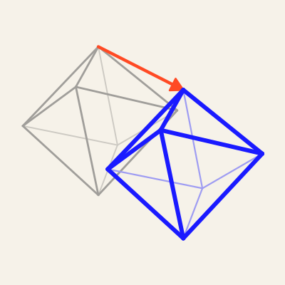

<p align="center"></p>

<h1 align="center">Vector Translation</h1>
<p align="center">A Vector Humanities method<br>
<sub>David M. Berry, University of Sussex · <a href="https://vector-humanities.github.io/vector-translation/">vector-humanities.github.io/vector-translation</a></sub></p>
<p align="center"><a href="https://doi.org/10.5281/zenodo.23715274"></a></p>

---

Vector translation is a method for translating book-length texts from page images. A coordinating agent directs parallel AI sub-agents through the source under a shared brief. Each passage is drafted twice, as a literal translation, sentence by sentence, and as the translation, in continuous prose, and each version is checked against the other and against the page images. The translator writes the brief, settles the terms and conventions, and corrects.

This repository holds the method as a procedure, the rules learned in practice, Claude Code skills for each stage, templates for briefs and records, and small scripts for checking and applying changes. It was first used on Kuki Shūzō's 偶然性の問題 (*The Problem of Contingency*, 1935), translated in October 2026 ([case study](method/case-kuki.md)).

## Disassembly and reassembly

Vector translation borrows a working comparison from software reverse engineering, where coding agents now drive decompilers to take a compiled program apart and rebuild source code that behaves like it, tested against the original. A vector translation takes a text apart and reassembles it in another language. The literal version stands where the disassembly listing stands: close to the source, sentence by sentence, and kept. The translation is the reconstructed source. The brief and the glossary do the work of naming, fixing what each part of the text is called before anything is rebuilt. The translation corpus works like a signature library, a record of renderings already attested. The checks take the place of tests. The comparison also marks a limit. A reconstruction judged only by whether it runs drifts towards the usual code of its kind, and a translation judged only by how well it reads in English drifts towards default English. The literal version is therefore published with the translation, and the checks that weigh most are made from outside the agents: by readers of the source language, by earlier translators, and by independent second drafts.

## Contents

| | |
|---|---|
| [`method/method.md`](method/method.md) | The procedure, stage by stage, with a checklist |
| [`method/rules.md`](method/rules.md) | Twenty-two rules, each with the incident behind it |
| [`method/languages/`](method/languages/) | Notes for [Japanese](method/languages/japanese.md) and [German](method/languages/german.md) sources |
| [`method/case-kuki.md`](method/case-kuki.md) | The first run, in figures |
| [`skills/`](skills/) | Claude Code skills: a coordinator and one per stage |
| [`templates/`](templates/) | Briefs, conventions sheet, glossary, survey, fact sheet, status, project `AGENTS.md`, Vector Book `book.toml` |
| [`tools/`](tools/) | `vt_check.py`, `vt_apply.py`, `vt_assemble.py`, `vt_corpus.py`, `vt_bookcheck.py` (Python 3, standard library only; the book check needs `pdftotext`) |
| [`brand/`](brand/) | The mark and its generator |

## Stages

| | Stage | Skill | The translator decides |
|---|---|---|---|
| 1 | Source survey: edition, rights, images, page mapping, every page, existing translations | `vt-survey` | edition; whether rights allow the project |
| 1a | Translation corpus: existing translations of the work, the author and the circle, as term tables, a style note and scholarly finds | `vt-corpus` | sources; removal of texts at sign-off |
| 2 | Pilot and conventions: pilot section, register page, core terms, decision sheet, glossary | `vt-pilot` | register, terms, every convention |
| 3 | Brief and batches: partition by headings, shared brief, parallel drafting | `vt-brief` | partition, hard passages |
| 4 | Merge and integrity checks, per part as it returns | `vt-merge` | new terms |
| 5 | Checking passes: read-through, terms, attributions, external check, concordance | `vt-check` | disputed readings |
| 6 | Apparatus: preface from a fact sheet, Translator's Note, appendices, figures | `vt-apparatus` | scope and contents |
| 7 | Book: handover to [Vector Book](https://github.com/vector-humanities/vector-book) through `book.toml`, builds from the first chapter, design samples, proof | `vt-book` | design, sign-off |

The coordinator skill, `vector-translation`, routes between them.

## Using the skills

Copy the skill folders into a project's `.claude/skills/` (or `~/.claude/skills/` for all projects), with `templates/` and `tools/` beside them in the translation project. Start a session in the project and ask to begin a vector translation; the coordinator skill reads `STATUS.md` and picks up from the current stage.

## Tools

```bash
python3 tools/vt_check.py text/translation.md --glossary glossary.csv
python3 tools/vt_apply.py fixes-*.md --target translation=text/translation.md --target literal=text/literal.md
python3 tools/vt_assemble.py text/translation --front front --back back -o build/translation.md
```

`vt_apply.py` is a dry run unless given `--write`, and refuses any change whose old text does not match exactly once.

## Status

Version 0.1.1, October 2026, distilled from one complete run. A German text from the Frankfurt School or its circle, in the public domain and not yet translated into English, is in preparation as the second.

## Citation

Berry, D. M. (2026) *Vector Translation: a method for translating books from page images with AI agents*. Version 0.1.1. Zenodo. https://doi.org/10.5281/zenodo.23715275

To cite every version, use the concept DOI, https://doi.org/10.5281/zenodo.23715274. `CITATION.cff` gives the same record for GitHub's "Cite this repository".

Licence: [GNU General Public License v3.0](LICENSE).
